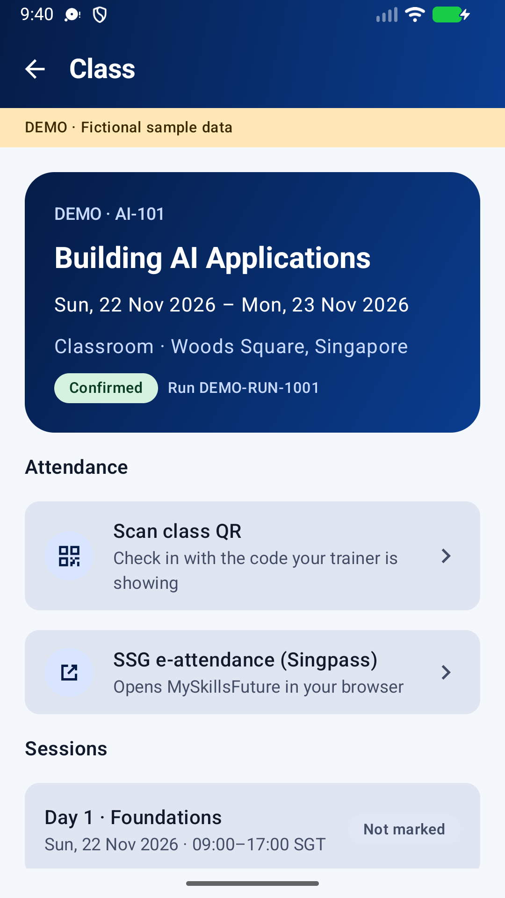

# TIA TMS — native Android

<p><a href="https://play.google.com/store/apps/details?id=com.tertiaryinfotech.ailmstms"></a></p>

Kotlin and Jetpack Compose companion for Tertiary Infotech Academy learners and trainers.

[](https://play.google.com/store/apps/details?id=com.tertiaryinfotech.ailmstms)

- Sign in with an email code or a password (existing accounts only), with encrypted local session storage and a forced password change when the academy requires one.
- Class page in the website's section order and names, laid out for the phone: a summary card (course code, run, class type and status, dates, venue with Google Maps, trainer, Join Google Meet / Zoom / Teams), then collapsible sections that start closed: Course Details, E-Attendance, SWDA Enrolment, Announcements, Courseware, Lesson, Course Feedback & TRAQOM Survey, Briefing on Assessment, Assessment, Assessment Summary Record, Assessment Grading and Post Course Feedback Summary.
- Courseware opens inside the app when it is a PDF (Google Drive, Slides and Docs links included), with zoom and a page indicator; anything else opens in the browser.
- Monthly class calendar in Singapore time; tapping a session opens its class.
- Learners: scan the class QR code to check in, open SSG e-attendance, submit assessment files, send course feedback.
- Class quizzes: scanning the trainer's quiz QR code (`https://lms-tms.tertiaryinfotech.com/quiz/<courseId>/<quizId>`) opens the quiz in the app: one question at a time, then the score with the correct answers, and Retake.
- Trainers: show a session's check-in QR code, mark attendance by hand, publish each assessment, record Competent / Not Yet Competent, open the SSG QR Attendance and E-Attendance List, and read the Post Course Feedback Summary (averages and comments, no names).
- Assessment Summary Record e-signing: learners sign as candidate, trainers as assessor (one by one or all at once), with a finger-drawn signature saved once.
- Profile editing and a light, dark or system theme saved to the profile.
- Push reminders three days and one day before each class, plus local alerts 24 hours before and at 08:00 on the day.
- Switch role for one email with several roles (Learner, Trainer, Developer); the admin Google sign-in (allow-listed academy admins) adds Admin; the owner account can switch between all four.
- Trainers also post announcements with a photo or file, grade from a roster (WA / PP ticks, TRAQOM tick, assessor signature on submissions) and hold ACLP, DDDPL and TAEPP badges with domain expertise and skill tags.
- Certificates to view and download; a learner Support tab (feedback, email, tel, WhatsApp, address); class status on every class card.
- Admin (read-only): Current and Upcoming classes, the academy calendar, the course catalogue with every course's runs (Confirmed, Pending or Cancelled, with the trainer of each confirmed run), and WhatsApp a trainer about a class. Developer: the course catalogue. No finance UI; class status and trainer assignment stay on the website.
- Clearly labelled fictional demo covering every screen, with no network calls.

## App preview



## Build

Requires JDK 17+, Android SDK 36 and the Gradle wrapper.

```sh
export JAVA_HOME='/Applications/Android Studio.app/Contents/jbr/Contents/Home'
./gradlew :app:testDebugUnitTest :app:lintDebug :app:assembleDebug
ANDROID_SERIAL=emulator-5554 scripts/run-ui-tests.sh   # AppFlowTest + screenshots into store/screenshots/files
./gradlew :app:bundleRelease
```

Use `local.properties` for the SDK path. Release signing uses the ignored
`keystore.properties` and `keystore/upload.jks`; the upload key is backed up outside
this project. Add the Firebase project's `google-services.json` to `app/` before
building a distribution bundle. Server credentials must never be placed in the app.

## Source layout

`app/src/main/java/com/tertiaryinfotech/ailmstms/`

| Path | Contents |
|---|---|
| `MainActivity.kt`, `LmsViewModel.kt`, `Push.kt` | Activity, app state and navigation, application class and FCM service |
| `data/` | Models, `Repository` (HTTP API), `DemoApi` (fictional data), session store, link rules, PDF download, brand colour check |
| `notify/` | Local class alerts: pure planning (`AlertPlanner`) and WorkManager scheduling (`ClassAlerts`) |
| `ui/` | Theme and one file per screen: sign-in, tabs, class, PDF viewer, attendance, assessments, feedback, quiz, profile, summary-record signing (`SummaryRecordScreen.kt`), Admin and Developer views (`StaffScreens.kt`) |

## Backend

API origin: https://lms-tms.tertiaryinfotech.com

Sign-in by email code, the dashboard and device registration use the `/api/android/*` routes.
Everything added in 1.1.0 (password sign-in, profile, class detail, attendance, assessments,
feedback) uses the shared `/api/mobile/*` routes, documented in `docs/mobile-app-api.md` of the
backend repository; the same session token works on both. Assessment files are uploaded to the
academy's Google Drive through `/api/upload/google-drive`. **Release 1.1.0 only after those
routes are deployed**: without them the app still signs in and lists classes, but class detail
falls back to the basic dashboard copy.

Class quizzes (1.2.0) use the routes the web quiz page uses, `GET /api/courses/quiz` and
`POST /api/courses/submit-quiz`, with the same session token. The quiz link is an Android App
Link: the manifest claims `https://lms-tms.tertiaryinfotech.com/quiz/…` with `autoVerify`, and
the server must list this app's signing certificates in `/.well-known/assetlinks.json` (it is
built from the tenant's settings) for the link to open the app without a chooser. Check with
`adb shell pm get-app-links com.tertiaryinfotech.ailmstms`.

Release 1.3.0 adds `GET /api/mobile/staff` (admin/developer only: classes by date, the course
catalogue, and trainers with WhatsApp numbers) and uses the portal's own routes for assessment
publishing (`/api/assessments/publish-link`), summary-record signing
(`/api/assessments/summary-record`) and saved signatures (`/api/learner/signature`,
`/api/trainer/assessor-signature`), each of which checks the class trainer or the enrolled learner.

The server owns push reminder scheduling and rechecks current assignments, enrollments and
account/session status. A `401` from any route signs the user out.

Courseware is downloaded without the session token (the hosts are third parties) into the
app's cache, only over https, only up to 60 MB and only when the file starts with `%PDF`.
Calendar insertion opens the user's calendar editor without calendar-read permission. The QR
scanner is Google Play services' code scanner, so the app has no camera permission; the file
picker is the system document picker, so it has no storage permission. Local alerts use
WorkManager (no exact-alarm permission) and can arrive a few minutes late.

## Skills imported

All four Android skills from the Codex user, shared user and Claude user roots are
preserved in `.skills/{codex,user,claude}/`. `skills-import.json` records their hashes.
Includes design, Play submission, automatic release and Feedback/About guidance.

## Release

Package: `com.tertiaryinfotech.ailmstms` · version 1.4.0 (9) · min SDK 26 · target SDK 36.
Store copy and assets are in `store/`; release notes are in `CHANGELOG.md` and
`distribution/whatsnew/`. See `store/release-status.md` for verified submission state.

Developed by Tertiary Infotech Academy Pte. Ltd.
