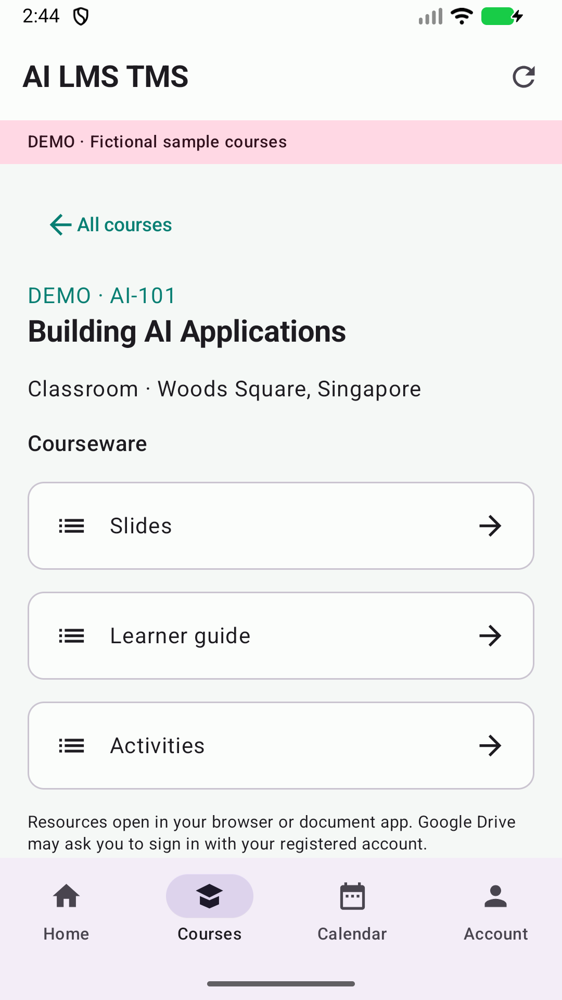

# AI LMS TMS — native Android

Kotlin and Jetpack Compose companion for Tertiary Infotech Academy learners and trainers.

- Email OTP for existing accounts, with encrypted local session storage.
- Personal courseware and monthly class calendar, displayed in Singapore time.
- Optional Firebase reminders three days and one day before each class.
- Learner/trainer switching where both roles are assigned; no administrative UI.
- Clearly labelled fictional demo, feedback, privacy policy and deletion-request links.

## App preview



## Build

Requires JDK 17+, Android SDK 36 and the Gradle wrapper.

```sh
JAVA_HOME='/Applications/Android Studio.app/Contents/jbr/Contents/Home' ./gradlew :app:assembleDebug
./gradlew :app:testDebugUnitTest :app:lintDebug
./gradlew :app:connectedDebugAndroidTest
./gradlew :app:bundleRelease
```

Use `local.properties` for the SDK path. Release signing uses the ignored
`keystore.properties` and `keystore/upload.jks`; the upload key is backed up outside
this project. Add the Firebase project's `google-services.json` to `app/` before
building a distribution bundle. Server credentials must never be placed in the app.

## Backend

API origin: https://lms-tms.tertiaryinfotech.com

The disjoint `/api/android/` endpoints in the AI-LMS-TMS backend implement existing
account checks, atomic OTP consumption, session-scoped course access, and device
registration. The server owns reminder scheduling and rechecks current assignments,
enrollments and account/session status. See `backend/docs/android-app.md` in the
separate backend checkout. Combined backend GitHub commit: `8d2ab4e17a1263ecc2ba276b8253237e8c777886`.

Material links open in an external browser/document app and may require a Drive
account. Calendar insertion opens the user's calendar editor without calendar-read
permission. Push requires internet, user permission and a valid session. Delivery
is not guaranteed at an exact second by Android/FCM.

## Skills imported

All four Android skills from the Codex user, shared user and Claude user roots are
preserved in `.skills/{codex,user,claude}/`. `skills-import.json` records their hashes.
Includes design, Play submission, automatic release and Feedback/About guidance.

## Release

Package: `com.tertiaryinfotech.ailmstms` · version 1.0.0 (1) · min SDK 26 · target SDK 36.
Store copy and assets are in `store/`; release notes are in `CHANGELOG.md` and
`distribution/whatsnew/`. See `store/release-status.md` for verified submission state.

Developed by Tertiary Infotech Academy Pte. Ltd.
